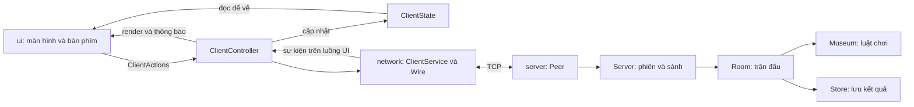

> Tài liệu lịch sử của bản trước. Bản 2 xem [kiến trúc](architecture.md), [luật chơi](rules.md), [kiểm thử](verification.md).

# Kiến trúc Museum Heist

Project là game Java Swing chơi hai người qua TCP. Cấu trúc dùng các phần
model, view và controller ở client, cùng một server có toàn quyền phân xử luật chơi.
Không cần thêm game engine, Maven hay framework để build.

## Luồng xử lý

`Room.prepare()` dùng `Museum.randomRound()` để tạo vị trí của hai nhân vật và hai báu vật trên các ô đi được, không trùng nhau hoặc cửa. Cửa cố định tại A7. STATE có thêm trường cuối chứa hai tọa độ báu vật; cả hai client phải dùng bản mới. Canvas đọc tọa độ từ `ClientState`, không dùng vị trí báu vật cố định.

Server quyết định kết quả. Client chỉ giữ dữ liệu được phép biết về vai của mình;
kiểm tra hành động ở client giúp báo lỗi sớm, server vẫn kiểm tra lại.

## Trách nhiệm từng phần

| Phần | Trách nhiệm | Sửa ở đây khi |
|---|---|---|
| `app/Main` | Khởi động chủ phòng và client | Đổi cách mở game |
| `app/ClientMain` | Đọc cấu hình, tạo controller, mở cửa sổ | Đổi IP/cổng mặc định |
| `client/controller/ClientController` | Xử lý thao tác, sự kiện TCP, cập nhật trạng thái, âm thanh | Thêm thao tác hoặc xử lý sự kiện |
| `client/controller/ClientActions` | Các callback từ view đến controller | Thêm thao tác người chơi |
| `client/model/ClientState` | Dữ liệu phiên, trận, lựa chọn và animation | Thêm trạng thái cần hiển thị |
| `client/model/OnlinePlayer`, `client/ui/TablePage` | Dữ liệu sảnh và trang bảng đã được controller giải mã | Thêm thông tin hiển thị từ server |
| `client/ui/GameWindow` | Vòng đời cửa sổ, chuyển màn, API cập nhật giao diện | Đổi bố cục chung hoặc vòng đời màn hình |
| `client/ui/AuthView` | Đăng nhập, đăng ký, cấu hình kết nối | Sửa biểu mẫu |
| `client/ui/LobbyView` | Danh sách người chơi và chọn đối thủ | Sửa sảnh |
| `client/ui/GameView` | Bảng điều khiển, thông số, nhật ký, phím tắt | Sửa giao diện trận đấu |
| `client/ui/MapCanvas` | Vẽ bản đồ, nhân vật, animation và xử lý click ô | Sửa hình ảnh bàn chơi |
| `client/ui/DataView` | Bảng lịch sử/xếp hạng và nút phân trang | Sửa bảng dữ liệu |
| `client/ui/UiTheme` | Màu, font, component dùng chung | Đổi phong cách giao diện |
| `client/ui/preview` | Dựng dữ liệu mẫu để xuất ảnh | Cập nhật ảnh minh họa |
| `client/network/ClientService` | Socket client, hàng đợi gửi, heartbeat | Sửa cơ chế kết nối |
| `common/network/Wire` | Định dạng thông điệp, mã hóa và giới hạn dòng | Sửa giao thức |
| `server/Peer` | Socket đọc/ghi của một người chơi | Sửa xử lý kết nối phía server |
| `server/Server` | Đăng nhập, online, lời mời, quản lý phòng | Sửa sảnh hoặc vòng đời server |
| `server/Room` | Trạng thái trận, nhịp, đổi vai, kết quả riêng mỗi vai | Sửa vòng đời trận |
| `common/model/Museum`, `Position` | Bản đồ, hành động, di chuyển, bắt/thoát, dấu vết | Sửa luật chơi |
| `client/audio/Audio` | Phát WAV, nhạc nền, âm lượng | Sửa âm thanh |
| `server/Store` | SQLite, transaction và nhập dữ liệu cũ | Sửa lưu trữ |

View giữ nút, nhãn và bảng của chính nó. View đọc model để render và phát callback;
không giữ socket, gửi thông điệp TCP hay ghi database. Controller không truy cập
trực tiếp các trường Swing; nó dùng các phương thức của `GameWindow`.

`ClientState` là đối tượng dữ liệu mutable cho một client, không chứa Swing hay I/O.
Controller cập nhật nó trên Swing event thread; các màn hình chỉ đọc.
Một số trường liên quan animation cũng nằm ở đây để canvas đọc cùng một trạng thái.

## Luồng và vòng đời

- `ClientService` chạy I/O trên luồng nền và nhận một `Executor` để giao sự kiện.
  Controller truyền `SwingUtilities::invokeLater`, nên xử lý trạng thái và UI cùng luồng.
- Swing timer chỉ cập nhật đồng hồ và repaint. Hết giờ/đổi nhịp được server quyết định.
- `Peer` đưa thao tác vào monitor của `Server`. `Room` được truy cập dưới cùng monitor,
  gồm cả đồng hồ server, tránh xử lý đồng thời hai quyết định trên cùng trận.
- Đóng client dừng timer, kết nối, âm thanh và các cửa sổ phụ; chủ phòng đóng cả server.
- `connectionVersion` loại bỏ callback từ kết nối cũ sau khi kết nối lại hoặc đóng game.

## Tương thích dữ liệu

Package khớp thư mục. `Store.java` nằm trong `src/nightchase/server/`.
Bộ đọc `Store.legacyInput` ánh xạ đúng ba tên `nightchase.Store$User`, `$Match`,
`$Data` sang các lớp ở package mới, giữ serialVersionUID và cấu trúc trường.
ObjectInputFilter vẫn giới hạn loại đối tượng và kích thước dữ liệu được đọc.
Fixture cũ được kiểm thử đăng nhập, thống kê, lịch sử, backup và tính toàn vẹn.

Tài nguyên nguồn nằm trong `res/audio`, `res/images`, `res/db`.
Build đóng gói nội dung `res/` vào gốc classpath, nên âm thanh vẫn được đọc từ
`/audio/...` và schema từ `/db/schema.sql` khi chạy JAR.

## Build và kiểm thử

- `build.bat`: tìm đệ quy file Java, biên dịch Java 17, đóng JAR với main class
  `nightchase.app.Main`. Mỗi build dùng thư mục output mới để không đóng nhầm lớp cũ.
- `test.bat`: kiểm thử SQLite/migration, luật chơi, server TCP, nhiều client,
  phân trang, cấu hình và UI. Mã test nằm theo package trong `tests/nightchase/`.
- `ClientFlowTest`: dùng hai controller/cửa sổ thật kết nối server TCP; đăng ký,
  đăng nhập, chọn đối thủ, chấp nhận lời mời, dùng bàn phím/khóa hành động,
  đóng đối thủ và đăng xuất. Kiểm tra cả callback UI lẫn cập nhật từ mạng.
- `tools/package-client.ps1`: tạo client JAR với main class `nightchase.app.ClientMain`.
- Xuất ảnh: `java -jar MuseumHeist.jar --preview build/ui-preview`.
- Công cụ GIF: compile `tools/DemoPreview.java` với classpath `MuseumHeist.jar`,
  chạy class `nightchase.client.ui.DemoPreview`.

Test ghi dữ liệu vào `work/`; không dùng thư mục dữ liệu thật `data/`.
